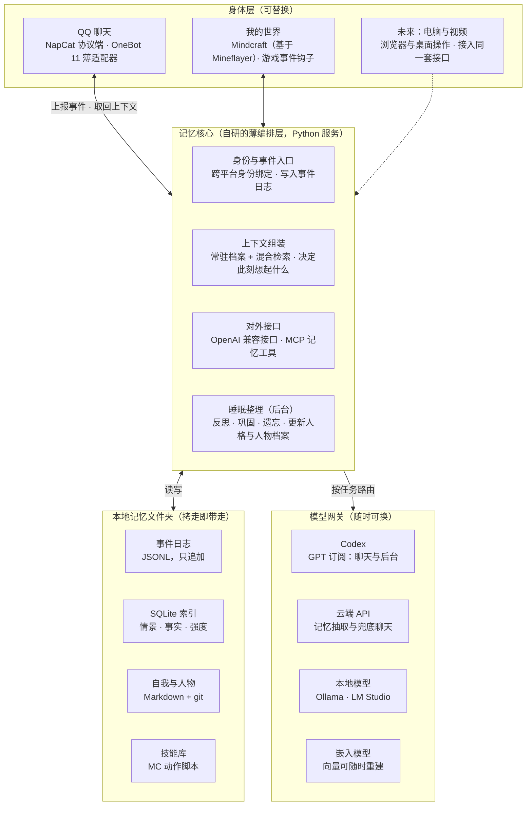
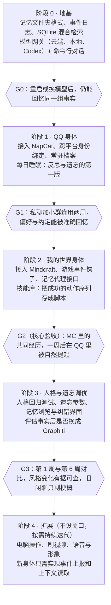

# 长期记忆 AI 伙伴系统：可行性与方向报告

> 2026-10-22 · 在线可编辑版：<https://claude.ai/artifact/LFNswtRTRsbzx1Au3JKD47>
> 本文件是在线版的快照。两张示意图在这里改用 Mermaid 重画，内容与在线版一致。

## 结论速览

**可行。** QQ 接入、我的世界控制、多模型接入、记忆存储和检索，都有成熟的开源零件。但没有任何现成项目同时做到“跨场景记忆 + 从记忆里长出的人格 + 像人一样遗忘 + 换模型不失忆”。这一层需要自研一个薄的记忆核心，它也正是这个项目的价值所在。

- **推荐路线**：自研 Python 记忆核心 + 一个本地记忆文件夹（事件日志 + SQLite + Markdown/git）。QQ 用 NapCat，我的世界用 Mindcraft，聊天优先用 GPT 订阅额度（经 Codex app-server），云端 API 与本地模型兜底。
- **换模型不失忆**：原始事件日志是唯一真相，事实、向量、摘要、人格都能用新模型重建。
- **人格会变**：人格是它每晚反思后自己改写的文件，git 记录每一次变化及其依据。
- **会遗忘**：遗忘是“想不起来”而不是删除，细节淡化成梗概，重要的事被钉住。
- **最大风险**：记忆质量，而非技术。编造回忆、抽取出错、人格漂移需要从第一天就有验收题库和纠错界面。
- **第一步**：先做记忆地基和命令行对话，再接 QQ，最后接我的世界做跨场景验收。

## 需求拆解

这个系统的本质是：**一个存在本地硬盘上的“自我”（记忆 + 人格），配一个可替换的“大脑”（模型）和若干可替换的“身体”（QQ、我的世界、电脑）**。真正的难点不在存储，而在三件事：记什么、什么时候想起来、怎么忘。

| 你的诉求 | 落地成什么能力 | 验收样例 | 难点 |
| --- | --- | --- | --- |
| 跨场景长期记忆 | 所有“身体”写入同一个事件流；同一个人在 QQ 和游戏里的身份要能对齐 | 周末在 MC 里一起盖了房子，一周后在 QQ 问“上次那个房子”，它能说出细节 | 什么时候主动想起（而不是只有被问到才检索）；跨平台身份绑定 |
| 人格随记忆演化 | 人格不是写死的系统提示词，而是从记忆中周期性提炼出的“自我认知”层 | 第 1 周和第 8 周的语气、称呼、口头禅有变化，且每个变化都能在记忆里找到来源 | 变化与稳定的平衡；防止被单个用户“带歪” |
| 本地存储、换模型不失忆 | 记忆以模型无关的格式落盘：原文 + 结构化文本 + 可重建的向量索引 | 从云端模型换到本地模型后，问同样的问题能回忆同样的事实，性格大体一致 | 换 embedding 模型要重建索引；不同模型对同一份人格“演”出来不一样 |
| 允许遗忘 | 记忆强度随时间衰减、被回忆时增强；细节逐渐压缩成梗概 | 三个月前闲聊的逐字内容想不起来，但记得“那天聊得很开心”；反复提到的偏好依然清楚 | 遗忘不等于删除，要可逆、可审计；承诺和重要事实不能忘 |
| 支持 Codex / API / 本地模型 | 统一的模型网关，按任务路由到不同模型 | 同一套记忆在三种后端下都能跑通对话 | Codex 是编程代理而非通用聊天 API，接入方式特殊（见模型接入层） |
| QQ + 我的世界作为验收 | 两个“身体”适配器，共用同一个记忆核心 | 见路线图中的验收标准 | 游戏内实时性要求高，不能每一步都走重型记忆检索 |
| 优先融合开源 | 记忆、接入、游戏控制均基于成熟项目，只自研“记忆核心的编排层” | — | 现有项目各自带一套记忆，需要统一到一个库里 |

## 开源调研 A：记忆系统

没有一个现成框架同时覆盖“跨场景 + 人格演化 + 遗忘 + 换模型”。它们是很好的零件，但需要一层自研编排把它们串起来。其中 Graphiti 的“事实有效期”和 memU / Letta 的“记忆即可读文件”最贴合本项目。

| 项目 | 定位 | 存储 | 更新 / 遗忘能力 | 对本项目的价值 |
| --- | --- | --- | --- | --- |
| [Graphiti](https://github.com/getzep/graphiti)（Apache-2.0，约 32.1k ★，v0.31.2，2026-10-20） | 时间知识图谱库（Zep 的开源内核） | Neo4j / FalkorDB / Neptune；Kuzu 已弃用 | 双时间轴事实：新信息与旧事实矛盾时，把旧事实标为失效而不删除，保留出处；无衰减 | 最适合“偏好会变”的事实层。明确支持 Ollama / vLLM / llama.cpp / LM Studio，但提示小模型可能抽取失败；Windows 上要用 Docker 或 WSL 跑图数据库 |
| [Mem0](https://github.com/mem0ai/mem0)（Apache-2.0，约 67.6k ★，Python SDK v2.2.1，2026-09-25） | 即插即用的记忆层，可作库或自托管服务 | 外接向量库（Qdrant、PGVector、Redis 等） | 2026 年 4 月新算法改为“只增不改”：一次抽取、不再更新或删除；无衰减 | 语义 + BM25 + 实体的三路混合检索值得借鉴；遗忘要自己做 |
| [memU](https://github.com/NevaMind-AI/memU)（Apache-2.0，约 14.6k ★，v1.5.1 稳定版，v2.0.0-beta，2026-07） | 跨 Agent 的个人记忆，“以 Wiki 形式存储” | Markdown 文件 + SQLite（默认）或 pgvector | 显著性加权与强化追踪；由宿主 Agent 决定新增或修补 | 记忆人能读、能改，核心逻辑约 500 行，已有 Codex 适配器；适合作为“自我 / 人物档案”层的参考 |
| [Letta](https://github.com/letta-ai/letta)（Apache-2.0，约 25.2k ★，源码已迁到 letta-code） | 完整的有状态 Agent 运行时（前身 MemGPT） | 用 git 管理的记忆文件系统（MemFS） | 后台“睡眠时”整理记忆、上下文压缩 | 借鉴“记忆是 git 里的文件”和“睡眠时整理”两个思路；整个运行时太重，不建议作底座 |
| [MemOS](https://github.com/MemTensor/MemOS)（Apache-2.0，约 12.0k ★，v2.0.34，2026-09-23） | “记忆操作系统” | 服务版 Neo4j + Qdrant；本地插件用 SQLite（FTS5 + 向量） | 用自然语言纠正记忆、去重、技能演化与闲置归档 | 功能最全也最重；其参数记忆、激活记忆依赖模型权重或 KV cache，与“换模型不失忆”相冲突 |

星数与版本为 2026-10-22 查看各仓库页面所得。各家自报的 LoCoMo / LongMemEval 分数互相矛盾，本报告不作为选型依据，建议用自己的验收题库评测。

**取舍结论**：不把任何一个框架当作“记忆的唯一真相”。真相是只追加的原始事件日志；事实、图谱、向量、摘要、人格都是可以用新模型重新生成的派生层。框架只是派生层的引擎，哪天不好用就换。

## 开源调研 B：伴侣与人格类项目

MaiBot 在“像人一样在 QQ 群里聊天”上最成熟，AIRI 在“多个身体”（游戏、语音、多平台）上最完整。但它们各自带一套人设和记忆，都不是跨场景的；适合当参考或“身体”，不适合当记忆核心。

| 项目 | 许可 / 热度 / 版本 | 强项 | 记忆与人格现状 | 建议用法 |
| --- | --- | --- | --- | --- |
| [MaiBot（麦麦）](https://github.com/Mai-with-u/MaiBot) | GPL-3.0；约 6.4k ★；v1.3.14，2026-10-21；Python 3.12+ | 为 QQ 群聊而生：模仿他人说话风格的“表达学习”、自主理解圈子梗的“黑话学习”、插件 SDK 与 MCP | 有向量长期记忆、带置信度的人物事实与人物画像；人格、行为风格、回复风格仍在 WebUI 里手工配置 | 重点参考其表达学习、黑话学习、人物画像的设计。其 MC 子项目 [Maicraft](https://github.com/MaiM-with-u/Maicraft) 自述暂停维护 |
| [AIRI](https://github.com/moeru-ai/airi) | MIT；约 50.6k ★；v0.12.0-beta.5；TypeScript / Vue | 自托管的虚拟伙伴，实时语音、Live2D / VRM、玩 Minecraft 和 Factorio；接 Discord、Telegram、Satori；支持 Ollama 等大量模型 | 记忆模块“Alaya”仍在开发；MC 机器人的“长期记忆、情绪、人格驱动”列在未来计划里 | “多身体”架构的最佳参考；其 MC 机器人的“感知 / 反射 / 意识 / 行动”四层设计值得照搬；后期要做形象与语音时可接入 |
| [AstrBot](https://github.com/AstrBotDevs/AstrBot) | AGPL-3.0；约 42.7k ★；v4.29.1，2026-10-17；Python | 平台最多（QQ / OneBot v11、Telegram、Discord、飞书等），1000+ 插件，支持 Ollama 与 LM Studio | 知识库、人设、自动上下文压缩；长期记忆靠社区插件 | 想一次覆盖多个聊天平台时，可以把它当“多平台身体”，写一个插件把消息转交给记忆核心 |
| [Open-LLM-VTuber](https://github.com/Open-LLM-VTuber/Open-LLM-VTuber) | 后端 MIT、新前端自定义许可；约 14.3k ★；v1.2.1 | 免手语音对话、Live2D、桌宠、可全离线跑本地模型 | README 称长期记忆“暂时移除”；人设靠提示词 | 后期“语音 / 形象身体”的候选；v2 正在重写 |

关键启示：这些项目都把人格写在配置里。把它们当“身体”用时，要关掉或绕过它们自己的人设与记忆，否则会出现“两个大脑”各记各的。角色卡类前端正是你想避免的“写死设定”范式，不作为基础。

## 开源调研 C：接入层

接入层全部有成熟开源可用，自研部分只剩几百行的薄适配器。QQ 用 NapCat 或 LuckyLilliaBot 提供 OneBot 11 协议，我的世界用基于 Mineflayer 的 Mindcraft。模型侧见后文“模型接入层”。

| 环节 | 首选 | 备选 | 要点 |
| --- | --- | --- | --- |
| QQ 协议端 | [NapCatQQ](https://github.com/NapNeko/NapCatQQ)：约 11.3k ★，v4.18.41（2026-10-21），OneBot 11，支持 Windows / Linux / Docker / macOS | [LuckyLilliaBot](https://github.com/LLOneBot/LuckyLilliaBot)：GPL-2.0，约 3.7k ★，v8.3.2（2026-10-12），同时支持 OneBot 11、Satori、Milky | NapCat 是自定义许可：禁止商用、修改版不得公开、未经许可不得基于其代码开发。作为独立进程、只通过协议通信不触及其代码。两者都是非官方协议，有账号风控风险 |
| QQ 消息处理 | 核心内置一个 OneBot 11 WebSocket 客户端（自研，很薄） | 给 AstrBot 写一个转发插件 | 整套机器人框架自带人设和记忆，会和核心抢“大脑”；只在需要多平台时才值得引入 |
| 我的世界身体 | [Mindcraft](https://github.com/mindcraft-bots/mindcraft)：MIT，约 5.9k ★，Java 版最高 1.21.11（推荐 1.21.6），支持 OpenAI、Anthropic、Gemini、DeepSeek、Qwen、Ollama、vLLM 等，支持多智能体 | AIRI 的 MC 机器人（四层认知设计，正在向 Fabric mod 迁移） | 底层是 [Mineflayer](https://github.com/PrismarineJS/mineflayer)（MIT，支持 1.8 到 26.1，v4.39.0，2026-09-06）。Mindcraft 自带记忆只有“加载上次会话”开关，正好由核心接管。README 警告：开启写代码能力时不要连公共服务器 |

**一个省力的接法**：核心对外暴露一个 OpenAI 兼容的聊天接口，内部先注入记忆和人格、再转发给真正的模型，并顺手记录对话。Mindcraft 这类支持自定义地址的身体，只要把模型地址指向核心就能接入，几乎不改其代码。游戏里的非对话事件（盖了什么、去了哪、谁死了）再加一个小钩子主动上报。

## 记忆架构设计

采用“一份事件日志 + 四类派生记忆 + 一个编排器”的结构。所有“身体”（QQ、MC、电脑）只做两件事：上报发生了什么，索取“此刻该想起什么”。

### 落盘格式：拷走文件夹就带走了灵魂

```
memory/
  events/2026-10.jsonl      原始事件日志，只追加，唯一真相
  self/                     自我认知（Markdown，git 版本化）
    identity.md             我是谁、在意什么、怎么说话
    style.md                从互动中学到的表达习惯
    journal/2026-10-22.md   每日反思日记
  people/
    xiaoming.md             对某人的了解：偏好、关系、共同经历梗概
  index.sqlite              派生层：情景摘要、带有效期的事实、记忆强度、全文与向量索引
  manifest.json             派生层由哪个模型 / embedding 生成，换模型时据此重建
```

文本和 Markdown 任何模型都读得懂，你自己也读得懂、改得了。向量只是缓存，换 embedding 模型就全量重算；git 历史就是人格演化的审计记录。

### 四类记忆

| 类型 | 存什么 | 例子 | 存储 |
| --- | --- | --- | --- |
| 情景记忆 | 发生过的事：谁、何时、哪个场景、什么感受 | “10 月 18 日在 MC 里和小明盖了木屋，他掉进岩浆两次” | SQLite + 向量 |
| 语义记忆（事实） | 关于人和世界的稳定事实，带有效期和出处 | “小明喜欢不加糖、加奶的咖啡，来自 7 月 3 日 QQ 聊天” | SQLite 事实表，后期可换 Graphiti |
| 自我与关系 | 对自己和每个人的整体认知 | `identity.md`、`people/xiaoming.md` | Markdown + git |
| 程序记忆 | 学会的技能 | MC 里“怎么造一个自动农场”的动作脚本 | 文件 |

### 写入：从事件到记忆

1. 身体上报事件：谁、在哪个身体和频道、何时、原始内容。人物表把 QQ 号和 MC 玩家名映射到同一个人，首次绑定由你确认。
2. 实时：写入事件日志，进入短期工作记忆（最近若干条）。
3. 一段会话结束或空闲一段时间后：生成情景摘要，抽取候选事实，给重要度和情绪打分。
4. 每日“睡眠”：反思并更新 `self/` 与 `people/`，按遗忘曲线巩固或淡化，合并重复事实。

### 读取：什么时候想起来

- **常驻上下文**：每轮都带上自我认知摘要、当前对话者的档案摘要、最近的共同经历。“它记得你”的手感主要来自这里，不依赖检索恰好命中。
- **被动召回**：每条输入走混合检索（关键词 + 向量 + 人物过滤 + 时间），按“相关度 × 记忆强度 × 重要度”排序取前几条。
- **主动想起**：场景线索触发，如回到 MC 里的老地方、“三个月前的今天”。由一个小模型判断值不值得说出口，避免句句都是“我记得……”。
- **实时场景降级**：MC 里的动作级决策不查长期记忆，只在聊天和规划时查，当前玩家档案常驻缓存。

## 人格：从记忆里长出来

人格 = 一个很小的“出厂种子” + 随记忆生长的自我认知文件。变化来自每日反思，每一次变化都要能追溯到具体记忆。这是它和“角色卡”的根本区别：角色卡是写给模型看的设定，这里是它自己写下的“我是谁”。

| 层 | 内容 | 变化速度 | 由谁修改 |
| --- | --- | --- | --- |
| 种子 `seed.md` | 几条核心气质与底线，如“好奇、嘴硬心软、不喜欢说教” | 几乎不变 | 只有你 |
| 自我认知 `identity.md` | 兴趣、习惯、对自己的评价，如“我最近迷上了红石电路” | 周级 | 每周反思 |
| 关系 `people/*.md` | 对每个人的态度、称呼、共同的梗、亲密度 | 天级 | 每日反思 |
| 表达风格 `style.md` | 口头禅、句式、表情包习惯、从群聊里学到的说法 | 天级 | 表达学习（参考 MaiBot） |
| 情绪状态 | 当下心情，随时间回归基线 | 分钟到小时 | 实时计算，不写入人格 |

**演化机制**：借鉴 [Generative Agents](https://arxiv.org/abs/2304.03442) 的“反思”。每晚取当天重要的情景，问“今天我对自己、对某人有了什么新认识”，生成候选修改，带上出处写入文件并 git 提交。

**稳定器**：变化要像人一样缓慢、有理由，而不是随风倒。

- 证据门槛：修改人格必须引用至少两条独立记忆，一句玩笑改不了性格。
- 幅度上限：每次反思只允许小步修改；与种子冲突时不覆盖，而记为“内心矛盾”，反复出现才提交给你审阅。
- 按人隔离：某人教的说话方式先只在和这个人互动时生效，在多人场景里反复出现才进入全局风格，防止被单个用户带歪。
- 可回滚：git log 就是“它如何变成现在这样”的历史，任何一次变化都可以查看和撤销。

## 遗忘机制

遗忘做在“想不起来”，而不是“删掉”。每条记忆有一个强度，随时间按遗忘曲线衰减，每被回忆一次就更牢固；强度足够低的细节被压缩成梗概，原文转入冷存档。思路来自 [MemoryBank](https://arxiv.org/abs/2305.10250) 对艾宾浩斯遗忘曲线的用法。

$$
R = e^{-\Delta t / S}, \qquad S_{\text{new}} = S \cdot (1 + k \cdot I)
$$

R 是当前可回忆程度，Δt 是距上次回忆的时间，S 是稳定度，每次被回忆时按重要度 I 增大。检索排序用“相关度 × R × 重要度”，情绪强烈的经历初始 S 更高，就像人更容易记住开心或难过的事。

| 阶段 | 触发条件 | 发生什么 |
| --- | --- | --- |
| 鲜活 | R 高 | 原文和摘要都能被检索 |
| 淡化 | R 低于第一阈值 | 只检索摘要，原话不再进入上下文：记得大概，记不清原话 |
| 压缩 | 同一时期多条淡化情景 | 合并成一条梗概，如“那一周经常一起挖矿” |
| 沉睡 | R 极低 | 从索引中移除，只留在冷存档；你主动提起具体细节时可以被“唤醒” |
| 真正删除 | 只有你明确要求 | 从日志和所有派生层彻底抹去，用于隐私 |

**不该被忘的**：承诺与约定、重要的日子、你明确说“记住这个”的内容、身份绑定、过敏等安全信息，这些直接“钉住”，不参与衰减。

**偏好变了不等于忘了**：旧偏好被新事实“标记失效”（Graphiti 的做法），而不是被衰减掉。所以它能说出“你以前喜欢加糖，后来改成不加糖加奶了”，这正是像人的地方。

## 模型接入层

可以用 GPT 订阅额度做聊天模型：在本地运行官方的 Codex app-server，用 ChatGPT 账号登录，把它内置的编程助手指令换成人格指令，就能当聊天后端用。额度快用完时自动切到 API 或本地模型；记忆抽取用一个固定的强模型。

| 后端 | 接入方式 | 适合的任务 | 注意 |
| --- | --- | --- | --- |
| GPT 订阅（经 Codex app-server） | 本地运行 `codex app-server`，ChatGPT 账号登录，JSON-RPC 通信 | 主聊天模型（OpenAI 模型，花订阅额度）；每日反思、给 MC 写技能脚本 | 额度按时间窗口限制，群聊可能很快用完；app-server 仍是实验性；只限个人本地使用 |
| 云端 API（OpenAI、Anthropic、DeepSeek、Qwen 等） | OpenAI 兼容接口，核心内一层薄封装 | 记忆抽取；订阅额度用尽时兜底聊天 | 按量计费 |
| 本地模型（Ollama、LM Studio、vLLM、llama.cpp） | 同样是 OpenAI 兼容接口，如 Ollama 的 localhost:11434/v1 | embedding、“要不要主动提起”的判断、离线和兜底聊天 | 小模型做结构化抽取容易出错（Graphiti 也在 README 中提示），抽取类任务建议用中等以上规模 |

**Codex 的关键事实**（[非交互模式](https://developers.openai.com/codex/noninteractive)、[app-server](https://developers.openai.com/codex/app-server)、[MCP](https://developers.openai.com/codex/mcp)、[高级配置](https://developers.openai.com/codex/config-advanced)、[认证](https://developers.openai.com/codex/auth)）：

- 当聊天后端的配置：`model_instructions_file` 指向人格指令文件，替换内置的编程助手指令；`personality = "none"`；`features.shell_tool = false` 与 `web_search = "disabled"` 关掉执行命令和搜索；沙箱只读。
- 每轮对话：先用 `thread/inject_items` 把检索到的记忆放进上下文（不触发用户回合），再用 `turn/start` 发送消息，`effort` 调低换取速度。可用模型以 `model/list` 返回为准。
- 额度管理：`account/rateLimits/read` 返回各时间窗口的已用百分比和重置时间，核心据此在接近上限时切到 API 或本地模型，重置后切回。
- 合规边界：文档写明 app-server 认证“从未被允许用于商业或托管服务”，本地或开源应用可以继续使用。所以它只能是你自己的本地伙伴，不能做成给别人用的服务。第三方“订阅转 API”代理不是官方通道，有账号风险，不建议。
- 延迟：多了一层 Agent 运行时，比直接调 API 慢，阶段 0 要先实测。QQ 里几秒的回复可以接受；MC 里的动作级决策不走它。
- 其他：`codex exec --json --output-schema` 适合后台批处理，如每日反思产出结构化结果；`codex mcp-server` 已被移除，但 Codex 可作为 MCP 客户端接入我们的记忆服务。

**换模型时怎么办**

1. 换聊天模型：记忆文件不动。不同模型“演”出来的语气会有差异，用一组固定的“人格回归题”对比新旧模型，必要时在 `style.md` 里补充示例对话，而不是改人格本身。
2. 换 embedding 模型：按 `manifest.json` 离线重算全部向量。
3. 换抽取模型：可选地从原始事件日志重新抽取事实层。建议抽取模型尽量固定，聊天模型随便换。

## 推荐总体架构与选型

推荐“三层加一个文件夹”：身体层和模型层全部复用开源，记忆核心自研，本地记忆文件夹是唯一需要长期保护的资产。



身体只管感知和行动，核心决定记什么、想起什么、怎么忘。换平台只动最上一层，换模型只动模型网关，记忆文件夹始终不变。

| 组件 | 选型 | 复用还是自研 |
| --- | --- | --- |
| QQ 协议端 | NapCatQQ，备选 LuckyLilliaBot | 复用，独立进程 |
| QQ 适配 | 核心内置 OneBot 11 客户端 | 自研，很薄 |
| 我的世界身体 | Mindcraft + Mineflayer，模型地址指向核心 | 复用，加事件钩子 |
| 记忆存储 | SQLite（全文 + 向量）+ Markdown + git | 复用基础设施，格式自定 |
| 事实层 | 先用 SQLite 事实表，阶段 3 评估是否换成 Graphiti | 先自研，后可复用 |
| 人格学习 | 参考 Generative Agents 的反思、MaiBot 的表达学习 | 自研 |
| 技能库 | 参考 [Voyager](https://arxiv.org/abs/2305.16291) 的可执行代码技能库 | 自研，后期 |
| 模型网关 | Codex app-server（订阅聊天）+ OpenAI 兼容客户端 + Ollama / LM Studio | 复用 |
| 对外协议 | OpenAI 兼容接口 + MCP 记忆工具 | 复用标准 |

## 分阶段路线图与验收标准

按“地基 → QQ → 我的世界 → 调优 → 扩展”推进，每个阶段以一个关口验收。G2 跨场景回忆是整个项目成立与否的核心验收。



阶段 0 先不接任何平台，用命令行把记忆格式和换模型流程跑通；地基不稳，后面接再多身体也只是各记各的。

验收题（做完就勾掉）：

- [ ] G0：告诉它 5 条个人事实，重启服务后全部答对
- [ ] G0：把聊天模型从 GPT 订阅切换为 API，同样 5 条仍能答对
- [ ] G1：第 1 天说“我喜欢不加糖、加奶的咖啡”，第 14 天让它推荐饮品，它主动用上
- [ ] G1：群里有人常开它玩笑，它对这个人的态度变化写进了人物档案，并能说出原因
- [ ] G2：在 MC 里一起盖房子，一周后在 QQ 问“上次盖的房子”，它说出地点或细节
- [ ] G2：在 QQ 里约好“周末一起去下界”，进入 MC 后它主动提起
- [ ] G3：git 历史里能看到人格文件的变化，每次都附有记忆出处
- [ ] G3：抽查 30 天前的闲聊，说不出原话，但能说出梗概
- [ ] G3：钉住的承诺 60 天后仍能准确回忆

## 风险与待你拍板的决策

最大的风险不在技术可行性，而在记忆质量：抽取错误、编造的“共同回忆”、人格漂移。这些需要从第一天就有验收题库和记忆纠错手段。

| 风险 | 后果 | 应对 |
| --- | --- | --- |
| 编造回忆 | 它“记得”一件没发生过的事，比忘记更伤信任 | 每条事实和情景带出处；没有出处的回忆用不确定的语气说 |
| 小模型抽取质量差 | 事实层被污染 | 抽取固定用强模型；事实带置信度；提供查看和纠正记忆的界面 |
| 人格漂移或被带歪 | 性格崩坏 | 种子锚定、证据门槛、按人隔离、git 回滚 |
| QQ 非官方协议 | 账号被风控或限制 | 用小号；控制发言频率；保持协议端可替换 |
| 许可证 | NapCat 禁止商用；MaiBot 为 GPL-3.0，AstrBot 为 AGPL-3.0，复制其代码会传染 | 只通过协议调用、不复制代码；借鉴设计而非搬运实现 |
| 群聊隐私 | 长期记住了群里其他人的话 | 告知群成员它会长期记忆；支持“忘掉这件事”；数据只在本地 |
| 用订阅额度聊天 | 额度用尽、接口变动（app-server 仍是实验性）、延迟偏高 | 监控额度并自动切换到 API 或本地模型；只做个人本地使用；核心不依赖它也能运行 |

已拍板的决策（2026-10-22）：

- [x] 核心语言：Python
- [x] QQ 协议端：NapCat
- [x] 发布：可能公开发布，不商用。NapCat 只作独立进程调用；本项目不复制 GPL / AGPL 项目的实现
- [x] 模型：ChatGPT Plus 订阅为主，5 小时额度耗尽后优先切换到指定的 API
- [x] 本地显卡：RTX 4070 Ti SUPER 16GB，暂无已部署的本地模型；先用于 embedding 和轻量判断
- [x] 群聊记忆：记住所有人（预计只接入约 4–5 人的小群）

## 补充调研（2026-10-24）：聊天改进与技能扩展

阶段 1 上线后，你提出了两类新需求：让聊天更聪明，以及给她加几样“技能”。下面逐项给出可行性结论。总的判断：**除“听歌”外都可行**；最关键的发现是 Codex 的权限配置能精确实现你要的 Agent 权限，且 Codex 可以改用 DeepSeek 作为模型，所以订阅额度用尽时 Agent 也能继续工作。

### 聊天的智能度

| 问题 | 原因 | 做法 | 结论 |
| --- | --- | --- | --- |
| 你连发“文字 + 表情包”，她回了两条（第二条回应表情，多余） | 每条消息都单独触发一次回复 | **消息合并**：收到要回的消息后先等一小会儿（私聊约 3 秒、可调），把同一个人接连发来的几条合成一轮再回 | 可行 |
| 有些消息根本不需要接话（比如只回了个表情） | 模型被要求“总要说点什么” | **允许沉默**：提示词告诉她不需要接话时只输出【不回复】，程序就不发 | 可行（qq-bridge 的 `[SILENT]` 也是这个思路） |
| 群里 @她 聊上之后，对方不再 @、直接接着说，她就不理了 | 现在只认 @、叫名字、引用她 | **对话延续状态机**（借鉴 qq-bridge 的“观望 → 活跃 → 试探 → 退出”）：她说话后进入“活跃”，刚和她聊的人在一定时间内接着说的话，交给模型判断要不要接（可沉默）；别人插进来的话判断更严格；一段时间没人理她就退出 | 可行；代价是活跃期内每条消息都要问一次模型，消耗额度 |
| 别人引用某条消息时，她不知道引用的是什么 | 现在只取被引用的图片 | **引用解析**：取出被引用消息的发送人和原文，写成“（引用了 X 的话：……）” | 可行 |

### 技能（身体）

| 技能 | 结论 | 做法与依据 | 需要注意 |
| --- | --- | --- | --- |
| 联网搜索与浏览网页 | 可行 | DeepSeek 提供独立的 [Search / Fetch API](https://api-docs.deepseek.com/guides/search)，用现有 API key 直接调用：搜索与抓取各 0.75 美元 / 千次，搜索 100 次/秒、抓取 25 次/秒。她在回复里写【搜索：关键词】，程序搜完把结果交回给她再作答；网页用 Fetch 转成 Markdown 阅读。Codex 也自带联网搜索（`web_search = "live"`），但慢且耗额度 | 计入 DeepSeek 月预算；搜索内容只用于回答，不进长期记忆（除非她自己觉得值得记） |
| Agent（调用 Codex 干活） | 可行 | Codex 的[权限配置](https://developers.openai.com/codex/config-reference)支持按路径设 `read` / `write` / `deny`：以只读为基础，专属文件夹设为可写，黑名单设为 `deny`（连读都不行），正好对应“文件夹内完全权限、外部只读、黑名单无权限”。订阅可用时用 ChatGPT 账号；额度用尽时，按 DeepSeek 官方的 [Codex 接入说明](https://api-docs.deepseek.com/quick_start/agent_integrations/codex) 改用 DeepSeek 模型（`wire_api = "responses"`）继续工作，不需要 DeepSeek Harness | 仅限主号私聊或本地命令行；Agent 用独立的 Codex 进程，与聊天进程分开；长任务要给进度；DeepSeek 驱动 Codex 需实测 |
| DeepSeek Harness（DSH） | 可行但不推荐 | qq-bridge 证明能通过 DSH 的本地 Web API 接入，但官方文档很少；上面“Codex + DeepSeek 模型”已能覆盖需求 | 暂不实装 |
| 生图 | 可行（仅订阅） | Codex 内置生图（gpt-image-2），结果以 `imageGeneration` 返回保存路径；按网上资料，生图消耗额度约是普通对话的 3–5 倍。DeepSeek 不能生图，订阅额度用尽时生图暂停 | 私聊不限；群聊按“20 分钟最多 N 张”限制 |
| 听歌与分享歌 | 部分可行 | **分享**：OneBot 有音乐卡片消息（QQ 音乐 / 网易云 / 自定义），但 NapCat 发音乐卡片需要配置签名服务地址（`musicSignUrl`），通常依赖第三方。**听**：她没有“听音频”的能力，只能读歌名、歌手、歌词、简介来“了解”一首歌；获取歌词多依赖非官方接口 | 列为可选，待你决定 |
| 我的世界 | 按原计划 | 阶段 2 内容不变，优先级排在上面这些之后 | — |
| 控制台开关 | 可行 | 每项技能在控制台有总开关和各自参数 | — |

### 一键启停与后台运行

可行。用 PowerShell 脚本（另配双击用的 `.bat`）管理四个部分：NapCat（`E:\07\NapCat.Shell.Windows.OneKey\…`）、Ollama（目前由它自己的托盘程序运行）、主程序 `companion qq`、控制台 `companion web`。

- 全部以隐藏窗口在后台运行；关掉命令行窗口也不会停。
- 日志写进 `data/logs/`，进程号写进 `data/run/`；停止脚本按进程号结束。
- 主程序崩溃后自动重启（守护进程，qq-bridge 的 `start.bat` 也这样做），并防止重复启动。
- 控制台改用固定令牌，地址可以收藏。

### 实测补充（2026-10-24，实装技能时）

- **联网搜索**：DeepSeek Search 约 2 秒、Fetch 约 1–5 秒；一轮“搜索后作答”用 DeepSeek 约 5 秒，用 Codex 订阅约 17 秒。
- **生图**：Codex app-server 返回 `imageGeneration` item（含 `savedPath`，图片存在 `~/.codex/generated_images/`）；一张图约 30–70 秒，约占 5 小时额度的 1%。用单独的 Codex 进程在后台画，不耽误聊天。
- **Agent 权限**：Windows 上用 `codex sandbox` 实测——黑名单读取被拒、工作文件夹外写入被拒、其余位置可读、工作文件夹可写，权限配置确实生效。盘符根目录（如 `C:/`）不能写进 filesystem 表，要用 `extends = ":read-only"` 打底。必须设 `approvals_reviewer = "user"`，否则 Codex 自己审批、不会转给我们。
- **Agent 的限制**：沙箱里的命令做不了 HTTPS（受限令牌拿不到 TLS 凭据，schannel 报 `SEC_E_NO_CREDENTIALS`），也启动不了本机装的 Python，所以联网改用 Codex 自带的搜索；审批通过后的提权命令在本机启动失败（`setup refresh had errors`），工作文件夹外的写入实际做不了，这反而更安全。
- **DeepSeek 驱动 Codex**：`model_provider` 指向 `https://api.deepseek.com/`、`wire_api = "responses"`，key 用 `env_key` 通过环境变量传入（不出现在命令行），实测能完成文件任务（约 60 秒一个小任务）。
- **安全加固**：用户的 Codex 配置会把 MCP 服务器和插件（含电脑操控 `cua_repl`、`node_repl` 等）带进 app-server。现在所有 Codex 进程都关掉这些（`features.computer_use / browser_use / plugins / apps … = false`，并逐个关闭配置里的 `mcp_servers`），避免群聊里的诱导借工具碰到本机。

### 实测补充（2026-11-08，群聊沙箱）

问题：能不能让 Codex 进程默认什么都读不到，只放开一个群的文件夹。环境：Codex 0.164，Windows 11 26200.9711，普通权限（未提权）运行。探针文件都是专门建的，放在黑名单之外。

| 配置 | 结果 |
| --- | --- |
| elevated 后端，只读打底（现有 Agent 的配置） | 别的群的文件夹、项目文件夹、同盘其他位置、临时目录都读得到；用户文件夹读不到 |
| elevated 后端，不含 `:root` | 拒绝运行：要求能读整个盘 |
| unelevated 后端，不含 `:root` | 拒绝运行：限制读取需要 elevated 后端 |
| mxc 后端，`:minimal` | 上面这些都读不到；但 Program Files、ProgramData 能读，里面真有别的软件的私钥（实测读到了长度，没看内容） |
| mxc 后端，`:minimal` 加显式拒绝（最终配置） | 全盘 4891 个目录，能列出的只有系统目录和放开的程序目录；3 个权限设得很松的软件目录要加进 `extra_deny` 才挡得住 |

mxc 下逐项实测（`codex sandbox`、app-server 的 `command/exec`、真实模型都试过）：

- **读**：PowerShell、cmd、Python 及其子进程都被拒绝；UNC（`\\localhost\E$`）、`\\?\` 长路径也被拒绝。
- **写**：只有群文件夹能写。能新建、覆盖、改名，不能删除。放开的程序目录是只读的。
- **链接**：符号链接、目录联接、硬链接都建不了。
- **工具**：apply_patch 在群文件夹里也失败，越界同样失败；view_image 起不来（都因为 Codex 的文件 helper 缺 `SYSTEMROOT`，加载 AGENTS.md 也是，所以要设 `project_doc_max_bytes = 0`）。这个 bug 修好后它们可能又能用，所以 view_image 显式关掉。代码模式的 `functions.exec` 里没有 `require`、`process`、`fetch`，动态导入被拒。`spawn_agent` 在临时线程里创建失败。提权参数被禁止。
- **网络**：外网、IP 直连、本机回环（Ollama 等本地服务）、DNS 全部不通；Python 同样。能在回环上监听（没测外面能否连进来，外面也没有东西会连它）。
- **环境变量**：默认全部继承，包括传给子进程的 API key；`shell_environment_policy.inherit = "core"` 后只剩基本的；`"none"` 启动不了（缺 `SYSTEMROOT`）。注册表 `HKCU\Environment` 和系统环境变量能读，文件权限管不到，所以自检会检查这些变量的名字。
- **系统**：计划任务、WMI、服务查询都不通；打开网址没有到达主机（用本机起的监听验证）；读不了剪贴板；`HKCU\...\Run` 读不了；后台进程随沙箱一起结束。
- **进程外的路径**：app-server 本身不在沙箱里，`.codex/config.toml` 里的 MCP 服务器会在沙箱外启动（这台机器上项目文件夹是 trusted，子目录都算），`AGENTS.md`、技能、`developer_instructions` 也会生效。线程工作目录换到沙箱写不到的地方后全部失效。主人私聊的 Agent 配置也实测确认有同样的问题。
- **两处踩坑**：收紧后 PowerShell 的模块加载不了（要放开 `Program Files/WindowsPowerShell`），此时扫描脚本全失败，看起来像“什么都列不出来”，是加了对照组才发现的假象。带着“不要越界”的提示时，模型根本不去试，所以验收时要去掉这句，否则通过了也不算数。
- **本机杀软**：探测脚本里同时写 socket 和 subprocess 的两个文件写完就被删了（疑似杀软，查不到检测记录），脚本拆开后正常。没有绕过这个防护，只是把测试按用途分开。

上游文档的说法（2026-11-08 查阅）：Codex 文档把 mxc 列为兼容设备上的推荐模式，要求 Windows 11 24H2 26100.9278 或 25H2 26200.9278 以上，显式选它时能力不够直接失败。MXC 文档说明，给“所有应用包”开了权限的目录，不在允许列表里也可能读得到，显式的拒绝规则优先；常见基线只是抽样观察，不是保证；`processcontainer` 用原生 BaseContainer，不回退到 AppContainer（本机二进制里还有旧版的回退字样，所以不能只信文档，要靠自检）。MXC 的 README 到 2026-10-06 还写着目前不要把它的配置当安全边界，那次提交删掉了警告，没有说明理由；当前读到的文档既没有重复，也没有收回。

### 新增来源（2026-10-24 查阅）

- [qq-bridge](https://github.com/Derpyu520/qq-bridge)
- DeepSeek：[Search / Fetch API](https://api-docs.deepseek.com/guides/search)、[Codex 接入](https://api-docs.deepseek.com/quick_start/agent_integrations/codex)、[价格](https://api-docs.deepseek.com/quick_start/pricing)
- Codex：[配置参考](https://developers.openai.com/codex/config-reference)；生图额度说明见第三方整理 [Image Generation in Codex CLI](https://codex.danielvaughan.com/2026/04/27/codex-cli-image-generation-gpt-image-2-visual-development-workflows/)
- [NapCat 文档](https://napneko.github.io/guide/boot/Shell)
- 沙箱（2026-11-08）：[Codex Windows 沙箱](https://learn.chatgpt.com/docs/windows/windows-sandbox.md)、[microsoft/mxc](https://github.com/microsoft/mxc)、[MXC 文件系统说明](https://github.com/microsoft/mxc/blob/main/docs/backends/process-container/filesystem.md)、[MXC schema](https://github.com/microsoft/mxc/blob/main/docs/schema.md)、[删除预览警告的提交](https://github.com/microsoft/mxc/commit/c51e49eac6aaac43edcb21296e91c26f18b66b33)

## 来源

仓库与文档均于 2026-10-22 查阅。

- 记忆系统：[Graphiti](https://github.com/getzep/graphiti)、[Mem0](https://github.com/mem0ai/mem0)、[memU](https://github.com/NevaMind-AI/memU)、[Letta](https://github.com/letta-ai/letta)、[MemOS](https://github.com/MemTensor/MemOS)
- 伴侣项目：[MaiBot](https://github.com/Mai-with-u/MaiBot)、[AIRI](https://github.com/moeru-ai/airi)、[AstrBot](https://github.com/AstrBotDevs/AstrBot)、[Open-LLM-VTuber](https://github.com/Open-LLM-VTuber/Open-LLM-VTuber)
- 接入层：[NapCatQQ](https://github.com/NapNeko/NapCatQQ)、[LuckyLilliaBot](https://github.com/LLOneBot/LuckyLilliaBot)、[Mindcraft](https://github.com/mindcraft-bots/mindcraft)、[Mineflayer](https://github.com/PrismarineJS/mineflayer)、[Codex](https://github.com/openai/codex)
- 论文：[MemoryBank](https://arxiv.org/abs/2305.10250)、[Generative Agents](https://arxiv.org/abs/2304.03442)、[MemGPT](https://arxiv.org/abs/2310.08560)、[Voyager](https://arxiv.org/abs/2305.16291)
