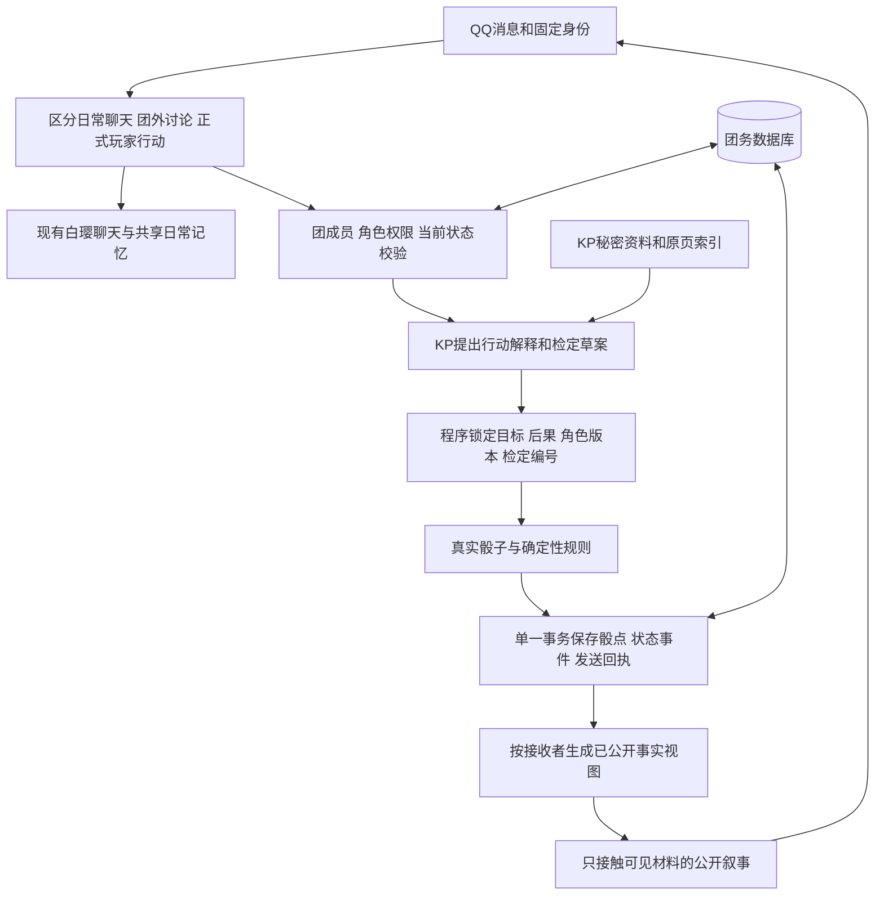

# 白璎 QQ 跑团系统：调研与建议设计

日期：2026-11-11。状态：**设计稿，除 [骰子](dice.md) 外尚未实现**。
结论：先做适合异步 QQ 单人/小队 CoC 七版的团务引擎，保留白璎的人格与日常记忆；
角色数值、检定和剧情状态由程序管理。现有持久线程供模型接续思路，不能取代团务数据库。
不需要先接入另一套 QQ 机器人、迁移现有项目或 fork Codex。

## 1. 从实际群聊确认的需求

已阅读本地 2026-11-11 的相关群聊和备团入口，本报告不复述模组秘密。

- 白璎担任 KP，当前希望单人适配，玩家已允许代骰。
- 沿用已确认的原人物卡；额外特殊能力暂不启用；适配和房规不能默默变成原作规则。
- 跑团期间旁观者的闲聊不应变成玩家行动，更不能影响计时或结算。
- 先公布检定依据和结果条件，再投骰。群中已有“幸运60找临时工具，找到不等于开锁”的待定例子。
- 规则需要按主题和页码检索；源书存在缺章、OCR和矛盾记录，不能假装已经完成规则校勘。
- 多天续团、每日睡眠、服务重启之后，要能确认真实进度，而不是依赖模型“记得”。
- 现有私聊/群聊日常记忆双向互通、每聊天独立文件夹继续保留。

本轮已经上线：真实随机、基础表达式、百分比难度、成功等级、奖惩骰、记录和请求去重。
尚未上线：角色卡绑定、正式检定请求、剧情状态自动提交、SAN/战斗、秘密权限、自动续团。

## 2. 参考了什么，以及本项目如何取舍

| 参考 | 已核对的能力 | 对白璎的建议 |
| --- | --- | --- |
| [Chaosium Quickstart](https://www.chaosium.com/cthulhu-quickstart/) | 官方提供七版基础入门和预设人物 | 基础核对从官方入门开始；完整规则以明确版本和出处核验，入门不能代替全部守密人规则 |
| [海豹核心指令](https://docs.sealdice.com/use/core.html) | 角色卡保存、绑定到群、独立卡与绑定卡分离；词条检索 | 借鉴明确的卡与群绑定；本项目默认按团复制人物卡，不默默跨团同步HP/SAN |
| [海豹CoC扩展](https://docs.sealdice.com/use/coc7.html) | 人物卡、检定、理智、成长、可配置房规 | 作为功能清单参考，不照抄其房规或全部指令；复杂规则分批核验实现 |
| [海豹队伍管理](https://docs.sealdice.com/use/team.html) | 团队成员的增删与按队伍操作 | 成员和角色必须显式登记，不能按昵称或最后发言者猜玩家身份 |
| [海豹日志](https://docs.sealdice.com/use/log.html) | 群内日志新建、暂停、继续、导出 | 本项目提供本地公开战报与KP日志；不默认上传到外部染色器 |
| [Foundry权限](https://foundryvtt.com/article/users/) / [日志资料](https://foundryvtt.com/article/journal/) | 用户角色与文档权限分层，秘密片段可单独公开 | 数据和检索接口按角色及内容可见性授权，不能仅提示模型保密 |

以上是产品能力核对，下面的事务、隔离和分阶段方案是结合本项目源码作出的设计判断。
没有安装、调用或复制上述产品代码。Chaosium链接的PDF因抓取体积限制未在本轮逐页核验，
因此复杂规则不以“已读完官方全文”为依据；后续规则模块须另做原页核验和测试。

## 3. 推荐结构

白璎仍是统一人格。需要拆分的是事实的权限和程序状态，而非把她拆成互相不认识的人。
KP筹划调用可以读取获准秘密，公开叙事调用只能读取已公开事实，不在同一个普通聊天线程混放全文秘密。
确定性引擎处理数字与约束，模型可以提出解释，不能直接覆盖数据库。

## 4. 谁能做什么

| 身份 | 允许 | 不允许自动发生 |
| --- | --- | --- |
| 本场KP/获授权主持人 | 确认规则、管理场景与NPC、公开线索、审核争议 | 修改已发布骰点；没有理由与记录地覆盖旧状态 |
| 玩家 | 操作绑定角色，提交行动，确认会改变角色状态的选项 | 用聊天报数修改别人的卡；事后改检定难度或刷骰挑结果 |
| 旁观者/其他机器人 | 团外闲聊，查询已公开且获准的战报；使用独立自由骰 | 推动角色行动、增加剧情耗时、修改NPC、消费正式检定请求 |
| 项目运维主人 | 服务启停、备份、配置身份；按明确授权管理本场 | 把“主号”默认等同于每个团的KP；把某玩家私聊自动当作全团共同知识 |

身份以 `PeopleRegistry.person_id` 和已认证的发送账号绑定，角色用独立 `character_id`。
昵称可以变，不作为权限依据。角色受伤、疯狂或犯罪是虚构世界状态，不写成真实玩家的人物事实。

异步QQ群先限制“一群一个活跃团”，其余团暂停。正式行动只取登记玩家在当前行动窗口内的输入；
多人团由明确的轮次/响应窗口归并，未到期不让最后发言的人代表全队。使用“团外：”区分规则讨论和行动。
旁观者的普通聊天仍可由日常白璎处理，不能因为进入跑团模式就永久忽略这些人。

## 5. 权威数据与存储

建议新数据放项目 E 盘受保护的 `data/trpg/`，先用 SQLite，不引入额外数据库服务。
普通文件工具、历史查询和跨聊天记忆检索不能直接读取受保护团资料；由专用服务按角色返回视图。
人物卡模板可以导入/导出，每个团保存实例，原始卡版本保留。

| 对象 | 至少保存什么 |
| --- | --- |
| campaigns | id、所属聊天、状态、KP、规则版本/房规、模组版本、叙事日期、状态版本号 |
| members / characters | 固定身份、角色归属、权限；属性技能、HP/MP/SAN/幸运、物品、状态、卡版本 |
| scenes / flags | 当前地点、NPC状态、已发生事件、线索可见性、机关/资源状态；非线性场景条件 |
| check_requests | 请求编号、操作者/角色、行动编号、技能与完整值、难度、奖惩、后果、来源、预期状态版本 |
| rolls / action_events | 不可覆盖的真实出目、规则快照、状态变更前后、来源消息与幂等键 |
| source_fragments | 文件SHA、版本、PDF物理页/印刷页、正文片段、可见性、校勘状态 |
| snapshots / outbox | 已提交事件水位和可重建快照；发送目标、内容类别、发送及确认状态 |

当前 `data/run/dice.sqlite` 继续保留为自由骰记录。正式团骰要与团状态存在同一数据库事务中，
复用本轮的纯表达式/百分比规则函数；不要嵌套调用会自行提交事务的 `Dice.run()`，
也不要先写一个数据库再无保护地扣另一个数据库的SAN。自由骰与团骰分清查询入口，不能挑一颗自由骰来结算正式请求。

## 6. 一次行动怎样可靠落地

1. 验证本群、团、成员、角色归属和行动窗口；去重 `source_message_id`。
2. KP根据当前可用事实提出解释；有风险或歧义先澄清。能直接观察到的常识不强迫投骰。
3. 建立并公开正式检定请求：例如“幸运60、常规、成功找到临时工具、失败消耗约定时间；不代表自动开锁”。
4. 程序固定角色值、难度、奖惩与后果；后改卡或改难度须使旧请求失效并重新确认，不能看完点数再改。
5. 按玩家代骰授权执行，幂等键采用 `campaign_id/check_id/attempt`。同一请求的再次调用返回原骰点。
6. 在一次数据库事务内保存出目、结论、实际允许的状态变化、事件水位及待发送记录。
7. 提交后才让公开叙事器读取本次可见结果；不让它自行增加伤害、线索或结局。
8. 发送后保存回执；结果未知时标明待核对，不为补通知再掷骰或重复扣点。

`proposed → awaiting_confirmation → ready → rolled → applied`；可以取消或失效，不能从失败退回ready重抽。
孤注一掷、花幸运等是明确的新操作/规则分支，要保留原骰与后果，不能伪装成网络重试。
并发提交使用 `expected_version`；冲突时重新读取状态，不能把两条玩家行动覆盖成最后一条。
模型措辞或后端切换失败只重试叙事，已经提交的点数与状态保持原样。

## 7. 现有记忆和持久线程怎样配合

- 日常长期记忆、人物关系与私聊/群聊近期经历继续沿用现有逻辑。
- 可分享的团内公开经历用 `fiction=true, campaign_id, visibility=public` 标识后生成摘要，
  让私聊也能聊“我们上次玩到哪里”；群内旁观者说的话保持来源，不变成角色事实。
- KP秘密和未揭示真相不进入通用记忆抽取、公共向量索引、跨聊天近期同步、主动问候、任务转述和日志导出。
  从原文到OCR、片段、摘要、缓存和派生事实都继承可见性，不只在最后输出时过滤。
- 团线程按 `campaign_id + 用途 + 可见性代次` 管理；普通聊天、KP筹划、公开叙事分别供给上下文。
  角色状态仍实时提交数据库，不等睡眠，不用压缩摘要替代完整行动账本。
- 每日睡眠继续整理日常记忆；团的快照从已提交事件生成，状态不因为04:00聊天轮换而重置。
  剧情中的“过了一天”与真实自然日、服务器停机分开；玩家离线不自动消耗剧情时间。
- 忘记/纠正日常记忆与回滚团事件是不同操作。团内回滚追加补偿事件、给出原因，并保留审计，
  不能让模型删除失败骰来改变历史。已经公开的内容也不能声称已从玩家记忆撤回。

## 8. KP资料保护必须在文件与检索层实施

当前备团资料放在群文件夹，现有文件工具允许同群成员读取。`仅KP`标题或提示词没有改变文件ACL。
因此当前只能视作逻辑分离，不能承诺保密；本轮骰子没有改变这一点。

后续资料迁移建议：

1. 导入为受保护资料，按片段标记 `kp_only / party / character / public`；公开手册与模组真相分开。
2. 对原PDF、完整MD、历史副本、路径别名、页图/OCR缓存及导出物一起检查；只藏一个新副本而留下原文不算隔离。
3. 已确认的敏感来源加入普通读文件/发文件/查文档/翻记录的权限校验；所有调用入口使用统一可见性服务。
4. KP只提出要公开的事实ID；程序核对触发条件和接收者。公开叙事器不接触秘密正文，
   不能把筹划模型返回的一整段自由文本直接当成已批准的公开材料。
5. 群文件夹只导出批准公开的手册、卡片和战报；KP全文留在私有资料库。原始文件保留，迁移有校验和回执，
   权限变更明确记录。过去已经公开的文件或群消息不能靠改文件夹宣称从未泄露。

初期允许“人类KP审阅新公开事实”，把可保密和可验证的流程跑通后，再扩大由规则自动允许的公开范围。
程序能保证工具和数据访问边界；对于模型持有完整秘密又自由生成文本的方案，不承诺绝不剧透。

## 9. 资料检索与世界模型

规则片段至少带：规则名、版本、文件指纹、物理页码、印刷页码（未知则空）、置信与校勘状态。
先使用已有PDF页码和主题MD索引；正文有争议时回原页，不靠向量相似度“投票”决定规则。
优先级建议：已确认的本团房规/适配 → 已明确采用的模组特例 → 锁定版本的基础规则；矛盾时提出KP裁定并记为裁定，
不能把模型推论或OCR错字改写成官方规则。

模组使用“场景/节点—线索—前提—公开条件—后果”的图，而不是把章节或房间编号当线性任务。
区分 `原文明示 / KP已采用改编 / 待裁定 / 模型建议`。单人适配不等于强行削SAN、给NPC自动救场或保证成功。
剧情计时使用确认的行动耗时；遇等待玩家、服务断线或旁观者闲聊时不推进追击与熄灯倒计时。

## 10. 后续规则扩展的顺序

| 批次 | 建议内容 | 完成前的约束 |
| --- | --- | --- |
| 现在 | 本轮基础/百分比/奖惩与记录 | 已上线；只给真实结果，不改角色与场景 |
| 第一批 | 团/成员身份、资料隔离、角色卡实例、开团/暂停/续团、正式检定请求 | 先通过越权与重复结算测试，再让程序改状态 |
| 第二批 | HP/MP/SAN/幸运、物品和线索、SAN损失流程与剧情日期 | 原页核对损失/临时与不定性疯狂等细则；先给提醒，复杂后果由KP确认 |
| 第三批 | 对抗、战斗顺序、闪避/反击、伤害/重伤、孤注一掷、花幸运、成长 | 分别建规则策略与案例；不能把一条“大成功优先”套给所有子系统 |
| 第四批 | 控制台卡片、关系/线索图、公开战报导出、多角色小队体验 | 多群与多团仍按权限独立；不默认公开KP资料或上传第三方 |

不建议开始就实现庞大的通用多规则VTT或自动执行模组全文。当前最有价值的是
“人物卡 + 正式检定 + 可恢复状态 + 可见性”，而不是先增加几十个缩写命令。

## 11. 对现有团的迁移

目前的 `07_初始状态.md` 是备团初始材料，群里之后已经有了实际开场和玩家行动。
不能直接拿初始文件覆盖当前进度，也不能把 `09` 中“建议、未采纳”批量当成已生效改编。

导入时结合最近已确认的玩家行动，生成一份不剧透的恢复草案：角色、位置、已知线索、资源、待定检定、已采用规则。
让本场玩家/KP核对有歧义的项；确认后建立首个团务版本。那次幸运60只保留为“待确认是否仍需要”，
上线骰子不会偷偷代投并判定找到物品。原记录和资料全部保留。

## 12. 验收用例与实现落点

最低验收：

1. 单人团中旁观者声称“我开门并获得线索”，角色、计时、线索均不改变。
2. 玩家A不能给玩家B改SAN；普通私聊、别的群和历史工具不能取出KP秘密。
3. 同一个正式检定重复消息、重启、后端兜底重试，只留一个出目，只扣一次资源。
4. HP/SAN更新失败就整体不提交；叙事失败不回滚已发布骰点；未知发送回执不触发重结算。
5. 目标和后果在骰点前锁定；看到失败后改卡会使版本冲突，不能套用更高技能值。
6. 日切、上下文压缩和崩溃后，位置、物品、剧情日期、待定请求及已揭示线索能从数据库恢复。
7. 私聊仍能回忆公开团经历，KP秘密不经近期回忆、长期抽取、附件、OCR或导出旁路泄露。
8. 未采纳适配不生效，缺章规则不编造，房规快照可以回查，非线性玩家路线不被强行纠正。

建议模块：`companion/trpg/{store,service,policy,rules,documents}`，对外只暴露受控业务工具，
QQ层负责身份和消息路由；`core/context.py` 选择日常/团务可见上下文；记忆抽取与跨聊天检索显式过滤秘密来源。
新文件格式和SQLite schema均带版本，支持不覆盖旧数据的迁移。查询和导出从同一服务读状态，
避免模型提示词、MD快照和控制台各保存一份互相矛盾的真相。

2026-11-11 后续已实现本设计的团务、正式检定、核心CoC规则、权限、资料索引、控制台与预算；功能边界及迁移操作见 [实现说明](trpg-system.md)。该文保留调研时的现状记录，不能把第8节的旧权限描述当作部署后的状态。复杂可选规则仍由KP裁定；未实现向外部模型发送KP秘密自动备团。
